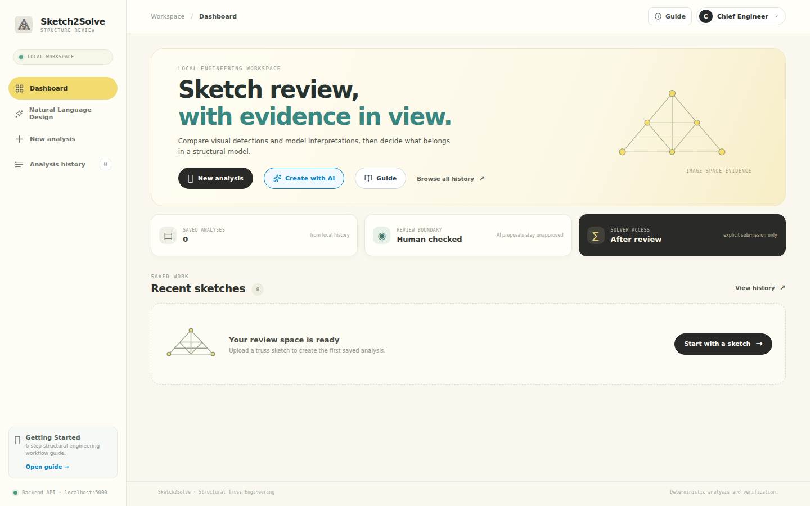
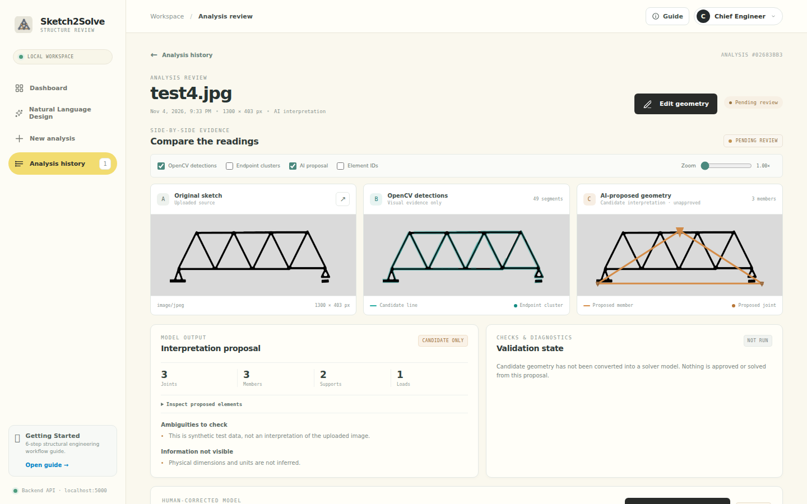
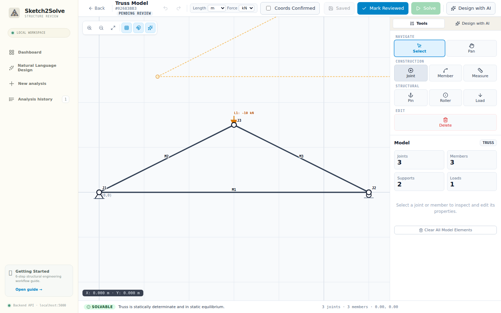
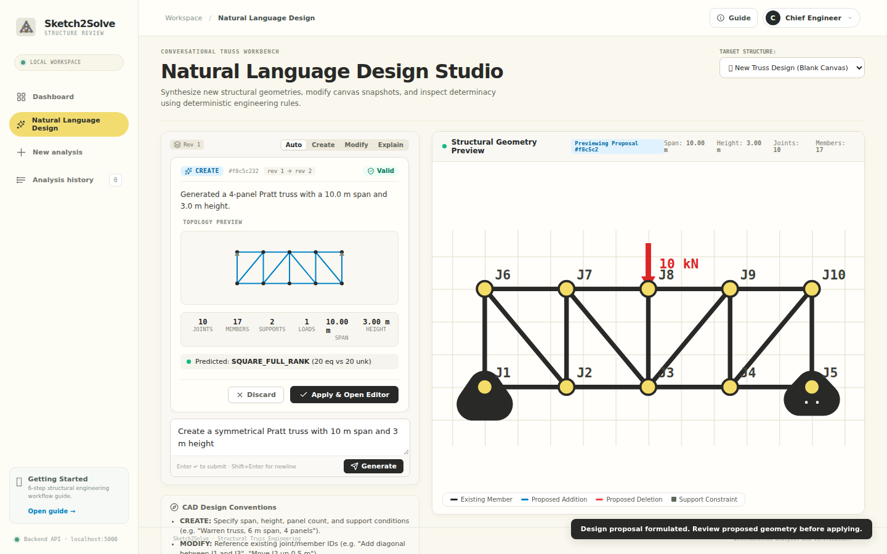
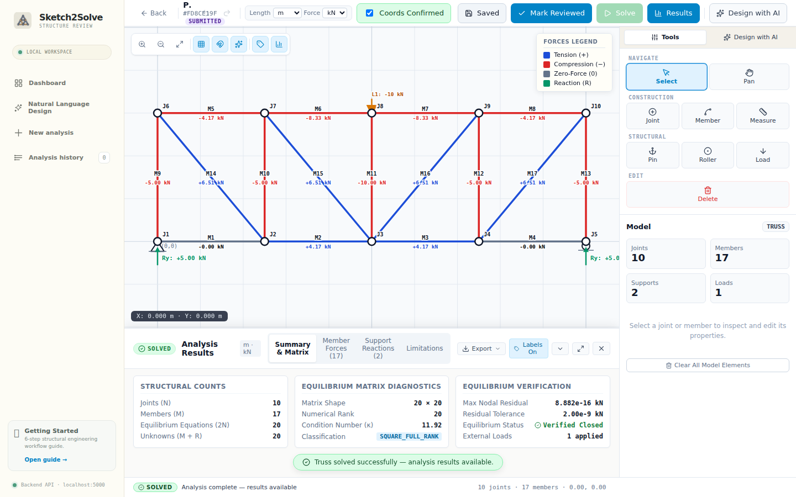
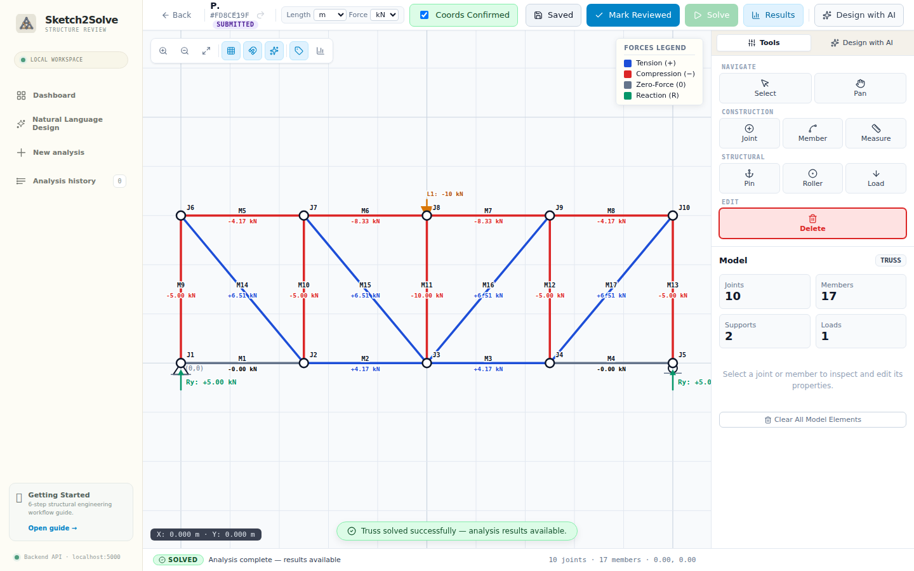

# Sketch2Solve

**Intelligent Structural Truss Perception, CAD Design & Deterministic Static Analysis Platform**

[](LICENSE)
[](https://www.python.org/)
[](https://vuejs.org/)
[](https://vitejs.dev/)
[](https://api.meta.ai/)

**Developer:** Athulkrishna S Nair
<br>**Event:** Meta AI Developer Hackathon
<br>**Repository:** [github.com/athulkrishnasnair/sketch2solve](https://github.com/athulkrishnasnair/sketch2solve)

---

## Overview & Tagline

> *From preliminary hand-drawn concept to mathematically rigorous equilibrium analysis in seconds.*

**Sketch2Solve** bridges the gap between conceptual civil/mechanical engineering ideation and quantitative structural analysis. By pairing multimodal computer vision with an interactive CAD editor, conversational design reasoning, and a deterministic linear-algebra solver, Sketch2Solve transforms rough hand-drawn sketches or natural-language prompts into fully validated 2D truss models with exact axial forces and support reactions.

---

## Problem Statement & Motivation

During early-stage engineering design, structural engineers, architects, and students frequently sketch planar truss ideas on paper, whiteboards, or digital tablets. However, evaluating these sketches traditionally demands tedious manual digitization into complex finite-element desktop software:

1. **Manual Entry Friction:** Engineers must transcribe node coordinates, redraw connectivity matrices, and manually re-specify boundary conditions.
2. **"Black-Box" AI Hazards:** Naive machine learning applications attempt to predict internal forces directly via neural networks, producing unverified approximations prone to structural hallucinations.
3. **Loss of Design Velocity:** Exploring parametric variants (e.g., span extensions, strut subdivisions, or height adjustments) requires re-entering CAD data from scratch.

### The Sketch2Solve Solution

Sketch2Solve solves this through a principled **hybrid architecture**:
- **Artificial Intelligence Proposes:** Meta Model API (`muse-spark-1.3`) and OpenCV extract candidate geometry from raw raster sketches and interpret natural-language design instructions.
- **Human Engineers Attest:** An explicit coordinate confirmation and human-in-the-loop review gate guarantees that AI output is verified before reaching the numerical solver.
- **Classical Mathematics Computes:** A deterministic matrix equilibrium engine ($[A]\{x\} = \{b\}$) computes exact internal member forces and support reactions with zero neural approximation.

---

## Application Showcase

| 01. Engineering Dashboard | 02. Multimodal Perception Review |
| :---: | :---: |
|  |  |
| *Unified workspace featuring recent analyses, quick actions, and project status.* | *Side-by-side evidence: original sketch, OpenCV segment detections, and AI proposal.* |

| 03. Interactive CAD Truss Editor | 04. Natural Language Design Studio |
| :---: | :---: |
|  |  |
| *Full-viewport CAD canvas with snap-to-grid, real-time preview, and inspection.* | *Split-pane conversational studio for iterative parametric modifications.* |

| 05. Equilibrium Solver Results | 06. Contextual AI Issue Assistant |
| :---: | :---: |
|  |  |
| *Color-coded axial forces (tension/compression), reactions, and SVD diagnostics.* | *On-canvas diagnosis of structural mechanisms with automated repair suggestions.* |

---

## Key Features

- **Multimodal Sketch Interpretation:** Upload photographs or scans of hand-drawn trusses (JPEG, PNG, WebP up to 10 MiB). The vision pipeline extracts candidate joints, members, support types, and applied loads.
- **OpenCV Evidence Extraction:** High-density probabilistic Hough transform and adaptive edge detection extract geometric line segments and endpoint clusters to contextualize model interpretations.
- **Natural Language Design Studio:** Synthesize initial trusses from plain English (e.g., *"Create a 12 m span Pratt truss with 3 m height"*) and apply iterative topological modifications (e.g., *"Subdivide the third panel"*, *"Change apex height to 4 m"*).
- **Interactive CAD Truss Editor:** Desktop-class SVG editing canvas with snap-to-grid, coordinate readouts, interactive node placement, member drawing, support toggling, load editing, and multi-step undo/redo history.
- **Real-Time Preview Recalculation:** Instant client-debounced preview evaluates draft geometry for kinematic mechanisms, degree of determinacy, and equilibrium solvability as you draw.
- **AI Issue Resolution Assistant ("Fix with AI"):** Contextual action cards flag disconnected nodes, missing reaction constraints, and rank deficiencies, delivering root-cause explanations and previewable, one-click automated repairs.
- **Deterministic Numerical Solver:** Assembles joint equilibrium matrices ($2j$ linear equations) and solves directly using `numpy.linalg.solve`, returning signed axial forces, reaction vectors, SVD condition numbers, and infinite-norm residuals.
- **Multi-Format Engineering Exports:**
  - **PNG:** High-resolution 200 DPI vector-accurate diagrams rendered with Matplotlib, showing tension/compression color-coding, member forces, and support reactions.
  - **JSON:** Complete structural specification conforming to Sketch2Solve Schema 1.0.
  - **CSV:** Tabular export of member axial forces and support reaction components with units.

---

## Architectural Workflow & Safety Gate

Sketch2Solve enforces a strict separation between perception, human attestation, and numerical computation:

```
+---------------------------------------------------------------------------------------------------+
|                                       SKETCH2SOLVE PIPELINE                                       |
+---------------------------------------------------------------------------------------------------+
|                                                                                                   |
|  [ Hand-Drawn Sketch ] (JPEG / PNG / WebP)                                                        |
|           |                                                                                       |
|           +---> [ OpenCV Feature Extraction ] (Adaptive Canny, Probabilistic Hough, Clustering)   |
|           |                                                                                       |
|           +---> [ Meta AI Multimodal Vision ] (muse-spark-1.3 Multimodal Perception)              |
|           |                                                                                       |
|           v                                                                                       |
|  [ Candidate Perception Proposal ] (Raw pixel coordinates; STRICTLY UNAPPROVED)                   |
|           |                                                                                       |
|           v                                                                                       |
|  [ Human Geometry Review & Attestation Gate ]                                                     |
|      - Physical unit selection (m, mm, ft / N, kN, lbf)                                           |
|      - Real-world coordinate verification (x-right, y-upward)                                     |
|      - Support and external load verification                                                     |
|      - Mandatory Attestation Checkbox (`coordinates_confirmed: true`)                             |
|           |                                                                                       |
|           v                                                                                       |
|  [ Strict Server-Side Schema Validation Gate ] (Version 1.0 JSON Specification)                   |
|           |                                                                                       |
|           v                                                                                       |
|  [ Deterministic NumPy Equilibrium Solver ]                                                       |
|      - Joint equilibrium matrix assembly: [A]{x} = {b}                                            |
|      - SVD condition & rank diagnostics (detects mechanisms, under-/over-determination)           |
|      - Exact direct solution (`numpy.linalg.solve`)                                               |
|      - Equilibrium residual check: ||[A]{x} - {b}||_inf < 10^-12 kN                               |
|           |                                                                                       |
|           v                                                                                       |
|  [ Analysis Dashboard & Multi-Format Exports ] (200 DPI PNG, Schema 1.0 JSON, CSV)                |
|                                                                                                   |
+---------------------------------------------------------------------------------------------------+
```

---

## Technology Stack

### Backend
- **Framework:** Python 3.11+ / Flask REST API
- **Mathematics & Solver:** NumPy (linear algebra, matrix assembly, SVD condition analysis)
- **Computer Vision:** OpenCV (`cv2`) for adaptive edge detection, grayscale morphological filtering, and probabilistic Hough transforms
- **AI Integration:** OpenAI Python SDK (`openai.OpenAI`) configured with Meta Model API (`https://api.meta.ai/v1`) using `muse-spark-1.3`
- **Database & Storage:** SQLAlchemy with SQLite for transactional persistence of analyses, drafts, and solver runs
- **Diagram Generation:** Matplotlib (headless Agg backend) for 200 DPI publication-grade exports

### Frontend
- **Framework:** Vue 3 (Composition API `<script setup>`)
- **Build Tool:** Vite 8 (Hot Module Replacement, fast production bundling)
- **Icons:** Lucide Icons (`lucide-vue-next`)
- **Graphics Engine:** Reactive SVG vector canvas with zoom/pan transforms, coordinate normalization, and tension/compression styling
- **Testing:** Playwright (end-to-end browser automation) and Node.js test runner (unit tests)

---

## Meta AI (`muse-spark-1.3`) & OpenCV Integration

### 1. Meta Model API Implementation
Sketch2Solve utilizes Meta's `muse-spark-1.3` foundation model across three key services:
- **Multimodal Sketch Perception (`app/services/muse_interpretation.py`):**
  Uses `client.responses.create` with Base64 data-URL payloads to extract joint nodes, member connectivity, boundary support conditions, and applied external load vectors directly from hand-drawn raster images.
- **Conversational Design Studio (`app/services/natural_language_design.py`):**
  Uses `client.chat.completions.create` with structured JSON mode (`response_format={"type": "json_object"}`) to translate natural language prompts into discrete geometry transformations (`add_joint`, `remove_member`, `add_member`, `update_joint`).
- **AI Issue Resolution Assistant (`app/services/ai_assistant.py`):**
  Analyzes validation errors, under-constrained systems, and kinematic mechanisms to deliver root-cause explanations and structured modification proposals.

*Reasoning Model Note:* `muse-spark-1.3` generates active chain-of-thought tokens (`reasoning_tokens`) prior to emitting JSON structures. Default service timeouts are configured to **75.0s** to ensure complete structural reasoning without client timeouts.

### 2. OpenCV Vision Pipeline (`app/services/perception.py`)
- **Pre-Validation:** Inspects binary headers, dimensions, and MIME types, rejecting corrupt or unsupported image formats prior to downstream processing.
- **Adaptive Filtering:** Converts input images to grayscale, applies Gaussian noise suppression, and computes dynamic Otsu and Canny edge thresholds.
- **Candidate Line Extraction:** Executes probabilistic Hough transforms (`cv2.HoughLinesP`) capable of processing high-density sketches (>300 candidate line segments) with bounded execution time ($< 0.5\text{s}$).
- **Spatial Bounding & Clustering:** Normalizes spatial distributions and extracts endpoint clusters to assist the multimodal model in snapping coordinates.

---

## Deterministic Truss Solver Mechanics

### Mathematical Formulation
For a 2D pin-jointed planar truss consisting of $j$ joints, $m$ members, and $r$ support reaction components:
- **Equilibrium Equations:** Each pin joint must satisfy static equilibrium in both coordinate directions:
  $$\sum F_x = 0, \quad \sum F_y = 0$$
  This yields $2j$ independent algebraic equations.
- **Unknowns:** The system contains $m$ internal axial member forces and $r$ external reaction components, giving $m + r$ unknowns.
- **Solvability Condition:** For a statically determinate system, the number of equations equals the number of unknowns:
  $$2j = m + r$$

### Sign Convention
- **Tension ($+$):** Positive axial force indicates tension (member pulling on joints). Rendered in **solid blue**.
- **Compression ($- $):** Negative axial force indicates compression (member pushing on joints). Rendered in **solid red**.
- **Zero-Force Members ($0$):** Axial force $< 10^{-6}\text{ kN}$. Rendered in **dashed gray**.

### Numerical Verification
The backend forms the equilibrium matrix $[A] \in \mathbb{R}^{2j \times (m+r)}$ and force vector $\{b\} \in \mathbb{R}^{2j}$:
$$[A]\{x\} = \{b\}$$
1. **Rank & SVD Check:** Computes singular values $\sigma_i$ via Singular Value Decomposition. If the numerical rank is deficient ($\text{rank}(A) < 2j$), the structure is identified as a kinematic mechanism or unstable assembly and rejected.
2. **Direct Linear Solve:** Solves $[A]\{x\} = \{b\}$ using LU factorization with partial pivoting (`numpy.linalg.solve`).
3. **Equilibrium Residual Attestation:** Verifies infinite-norm residual:
   $$\| [A]\{x\} - \{b\} \|_\infty < 10^{-12}\text{ kN}$$
   Any solution with residual exceeding $10^{-5}\text{ kN}$ is rejected.

---

## Installation & Setup Instructions

### Prerequisites
- **Python:** Version 3.11, 3.12, or 3.14
- **Node.js:** Version 18+ (Node 20+ LTS recommended) and **npm** 9+
- **Git**

### 1. Clone the Repository
```bash
git clone https://github.com/athulkrishnasnair/sketch2solve.git
cd sketch2solve
```

### 2. Backend Setup
```bash
cd backend

# Create virtual environment
python3 -m venv .venv
source .venv/bin/activate  # On Windows: .venv\Scripts\activate

# Install Python dependencies
pip install -r requirements.txt

# Configure environment variables
cp .env.example .env
```

Edit `backend/.env` with your Meta Model API credentials:
```ini
MODEL_API_KEY=your_meta_api_key_here
MODEL_BASE_URL=https://api.meta.ai/v1
MODEL_NAME=muse-spark-1.3
# Optional: comma-separated allowed origins for production CORS
# CORS_ORIGINS=http://localhost:5173,http://127.0.0.1:5173
```

Start the Flask backend service:
```bash
python run.py
# Backend API active on http://127.0.0.1:5000
```

### 3. Frontend Setup
In a separate terminal window:
```bash
cd frontend

# Install Node dependencies
npm install

# Start Vite development server
npm run dev
# Frontend active on http://localhost:5173
```

Open your browser and navigate to `http://localhost:5173`.

### 4. Production Deployment to Render

Sketch2Solve is configured for 1-click deployment on [Render](https://render.com/) using the included [`render.yaml`](render.yaml) blueprint specification:

- **Backend Web Service**: Flask application served via Gunicorn WSGI (`0.0.0.0:$PORT`) with OpenCV and Meta Model API (`muse-spark-1.3`) integration.
- **Frontend Static Site**: High-performance Vue 3 application built with Vite and distributed globally via Render CDN with automated client-side rewrites.

For complete step-by-step instructions, database persistence strategies, and dashboard settings, see the [Render Deployment Guide](docs/RENDER_DEPLOYMENT.md).

---

## Step-by-Step User Guide

### Workflow A: Sketch-to-Analysis
1. **Intake:** Click **New analysis** on the sidebar or dashboard.
2. **Upload:** Drag and drop a sketch (e.g., sample from `backend/evaluation/sketches/test4.jpg`).
3. **Inspect Evidence:** View the original sketch alongside OpenCV segment candidates and the Meta AI proposal overlay.
4. **Edit & Confirm:** Click **Edit geometry** to open the interactive CAD Truss Editor.
5. **Attest Coordinates:** Verify scale units (`m`, `mm`, `ft`), check the **Coords Confirmed** box, and adjust nodes if necessary.
6. **Review & Solve:** Click **Mark Reviewed**, then click **Solve**. Confirm submission to compute equilibrium forces.
7. **Export:** Click **Export** in the results header to download PNG diagrams, Schema 1.0 JSON, or CSV tables.

### Workflow B: Natural Language Design Studio
1. **Navigate:** Click **Natural Language Design** in the sidebar navigation.
2. **Prompt:** Enter structural requirements (e.g., *"Create a triangular truss with 10 m span and 3 m height, pinned support on left, roller on right, and 20 kN downward load at apex"*).
3. **Review Proposal:** Inspect the generated engineering proposal card and interactive SVG preview.
4. **Iterate:** Enter follow-up instructions (e.g., *"Add a vertical member at the midpoint of the bottom chord"*).
5. **Apply:** Click **Apply to Editor** to promote the proposal into the CAD canvas for review and static solving.

---

## Supported Image Formats & Upload Constraints

| Parameter | Specification | Details |
| :--- | :--- | :--- |
| **Supported Formats** | JPEG (`.jpg`, `.jpeg`), PNG (`.png`), WebP (`.webp`) | Binary magic-byte header validation via `inspect_image_header()` |
| **Maximum Upload Size** | 10 MiB ($10 \times 1024 \times 1024$ bytes) | Enforced on both frontend dropzone and backend HTTP handler |
| **Coordinate Space** | Original image pixel space $\to$ Physical engineering units | Mapped explicitly by the human reviewer before solver entry |
| **Dimension Bounds** | Minimum $64 \times 64$ px, Maximum $8192 \times 8192$ px | Prevents corrupt or zero-dimension memory allocations |

---

## API Overview

| Method | Endpoint | Description |
| :--- | :--- | :--- |
| `GET` | `/api/health` | Health check endpoint returning service status. |
| `POST` | `/api/analyze` | Direct solver endpoint accepting Schema 1.0 JSON and returning solved forces. |
| `POST` | `/api/analyses` | Multipart upload endpoint running OpenCV perception and Meta AI interpretation. |
| `GET` | `/api/analyses` | Paginated listing of recorded analyses with review statuses and timestamps. |
| `GET` | `/api/analyses/<id>` | Full analysis record (sketch metadata, perception, draft, solver results). |
| `GET` | `/api/analyses/<id>/image` | Streams original sketch image with secure non-caching headers. |
| `GET` | `/api/analyses/<id>/draft` | Retrieves human-review geometry draft and original AI proposal. |
| `PUT` | `/api/analyses/<id>/draft` | Saves user-corrected geometry draft (requires `coordinates_confirmed: true`). |
| `POST` | `/api/analyses/<id>/preview` | Non-persistent live calculation preview evaluating stability and determinacy. |
| `POST` | `/api/analyses/<id>/review` | Validates geometry schema and promotes status to `reviewed`. |
| `POST` | `/api/analyses/<id>/solve` | Executes deterministic static solver on reviewed geometry. |
| `GET` | `/api/analyses/<id>/export` | Generates file downloads in `png`, `json`, or `csv` formats. |
| `POST` | `/api/ai/design` | Conversational design endpoint translating prompts into geometry operations. |
| `POST` | `/api/ai/design/apply` | Applies proposed design modifications to active analysis record. |
| `POST` | `/api/ai/assistant` | AI issue diagnosis endpoint suggesting structured structural fixes. |

---

## Testing & Verification Results

The application has undergone comprehensive verification covering live Meta AI integration, static solver mathematics, responsive layout, and UI stability:

| Verification Suite | Execution Command | Result | Details |
| :--- | :--- | :--- | :--- |
| **Backend Unit & Integration** | `python -m unittest discover -s tests -v` | **171 / 171 passed** (2.28s) | Solvers, routes, exports, perception, safety gating |
| **Frontend Unit Tests** | `npm run test:unit` | **48 / 48 passed** (248ms) | Components, API client, contracts, design tokens |
| **Frontend Production Build** | `npm run build` | **Passed (0 warnings)** (729ms) | Vite client build, bundle size verification |
| **Playwright E2E Responsive** | `npx playwright test tests/e2e/responsive-layout.spec.js` | **8 / 8 passed** (15.9s) | Desktop 1440px, Tablet 1024px/768px, Mobile 390px |
| **Live AI Stress & Reliability** | `python scratch/stress_test_ai.py` | **4 / 4 passed** (431s) | **10 / 10 live iterations** on Meta `muse-spark-1.3` |

*For complete live AI verification logs and audit details, see [`REAL_AI_VERIFICATION_REPORT.md`](REAL_AI_VERIFICATION_REPORT.md).*

---

## Engineering Limitations & Caveats

1. **Statically Determinate 2D Trusses Only:** The solver computes classical pin-jointed direct equilibrium for square systems ($2j = m + r$). Statically indeterminate trusses ($2j < m + r$) require material stiffness matrices ($EA/L$) not implemented in this release.
2. **Hand-Drawn Ambiguities:** Visual sketches lack absolute physical metric scale. OpenCV lines and AI proposals are geometric candidates, not ground truth. Human review is strictly required.
3. **Equilibrium Does Not Establish Structural Safety:** Numerical convergence of $[A]\{x\} = \{b\}$ confirms only that static equilibrium is satisfied under idealized pin-joint assumptions. It does **not** evaluate:
   - Euler buckling of compression members ($P_{cr} = \frac{\pi^2 EI}{(KL)^2}$)
   - Material yield or tensile rupture ($\sigma \le F_y$)
   - Connection tear-out, gusset plate stresses, or weld shear
   - Deflection and serviceability limits ($L/360$)
   - Building code compliance (e.g., AISC 360, Eurocode 3, ASCE 7)
4. **Educational & Preliminary Tool:** Sketch2Solve is an educational and preliminary conceptual engineering aid. It is **not** certified structural engineering software and must never be used for actual construction, fabrication, or permitting without certified engineer attestation.
5. **Network & Service Dependencies:** Live AI interpretation and natural-language design require active network connectivity and valid Meta Model API credentials.

---

## Security Considerations

- **Credential Containment:** `MODEL_API_KEY` is loaded strictly on the backend. No API keys are passed to frontend client bundles, recorded in client storage, or output in API responses.
- **Environment Isolation:** Git ignores `.env` and local database files. Only `.env.example` with placeholder strings is tracked.
- **Sanitized Error Messaging:** Server errors wrap underlying provider exceptions into sanitized domain codes (`MUSE_API_ERROR`, `MUSE_TIMEOUT`, `MUSE_NETWORK_ERROR`), preventing raw stack traces or internal host parameters from leaking to clients.
- **CORS Safeguards:** Cross-Origin Resource Sharing is restricted via `CORS_ORIGINS` to explicit development ports (`5173`, `5174`, `4173`, `3000`) and configurable production origins, preventing unauthorized cross-origin invocations.
- **Attestation Gating:** The static solver rejects draft submissions unless `coordinates_confirmed: true` is explicitly posted by an authenticated client session.

---

## Future Roadmap

The following architectural expansions are envisioned for subsequent development phases:

- [ ] **Stiffness Method (FEM) Solver:** Support statically indeterminate trusses and frame structures using element stiffness matrices ($[K]\{u\} = \{F\}$).
- [ ] **Material & Cross-Section Database:** Library of standard structural steel shapes (AISC wide-flange, HSS, angles) with automated allowable stress and slenderness checks.
- [ ] **Euler Buckling Prediction:** Calculate critical buckling capacity for all compression members based on effective length factors ($K$).
- [ ] **3D Space Truss Analysis:** Extend equilibrium matrix assembly to three dimensions ($3j$ equations per node).
- [ ] **Direct DXF / STEP Export:** Export verified geometry directly into commercial CAD packages (AutoCAD, SolidWorks, FreeCAD).

---

## License

This project is licensed under the **MIT License** — see the [LICENSE](LICENSE) file for details.

Copyright (c) 2026 Athul Krishna Nair. All rights reserved.
