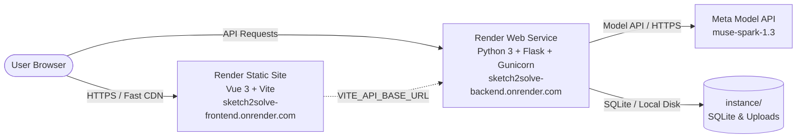

# Deploying Sketch2Solve on Render

This guide provides end-to-end instructions for deploying Sketch2Solve to [Render](https://render.com/).

---

## Architecture Overview

Sketch2Solve is structured for zero-cost, high-performance deployment using two complementary Render services:



1. **Frontend Static Site (Free)**: Built with Vite and Vue 3. Hosted on Render's global CDN with zero cold-start delays, automated HTTPS, and unlimited static asset distribution.
2. **Backend Web Service (Free / Starter)**: Python Flask application served via Gunicorn WSGI with asynchronous worker threads, OpenCV headless perception, and Meta Model API (`muse-spark-1.3`) integration.

---

## Deployment Options

You can deploy Sketch2Solve using either:
- **Option A**: **Render Blueprints (`render.yaml`)** — 1-click automated setup.
- **Option B**: **Manual Dashboard Setup** — step-by-step configuration in the Render UI.

---

## Option A: Automated Deployment via Blueprint (`render.yaml`)

The repository includes a ready-to-use [`render.yaml`](file:///home/athulkrishna_s_nair/sketch2solve/render.yaml) blueprint specification.

### Steps:

1. Push your repository to GitHub or GitLab.
2. Log in to [Render Dashboard](https://dashboard.render.com/).
3. Click **New +** in the top navigation and select **Blueprint**.
4. Connect your Sketch2Solve Git repository.
5. Render will detect `render.yaml` and display the two configured services:
   - `sketch2solve-backend` (Web Service)
   - `sketch2solve-frontend` (Static Site)
6. Enter the required secret environment variable:
   - `MODEL_API_KEY`: Your Meta Model API key.
7. Click **Apply**. Render will automatically build and deploy both services.
8. Once the initial build finishes:
   - Note the assigned backend URL (e.g., `https://sketch2solve-backend.onrender.com`).
   - Note the assigned frontend URL (e.g., `https://sketch2solve-frontend.onrender.com`).
   - In the **Frontend Static Site Settings → Environment**, set `VITE_API_BASE_URL` to your backend URL and trigger a manual redeploy.
   - In the **Backend Web Service Settings → Environment**, set `CORS_ORIGINS` to your frontend URL.

---

## Option B: Manual Dashboard Deployment

If you prefer configuring the services manually in the Render dashboard:

### Part 1: Deploy the Backend Web Service

1. Click **New +** → **Web Service**.
2. Select **Build and deploy from a Git repository** and pick your repository.
3. Configure the following fields:

| Field | Value | Notes |
| :--- | :--- | :--- |
| **Name** | `sketch2solve-backend` | Or any unique name you prefer |
| **Region** | Oregon (US West) or Frankfurt (EU) | Choose the region closest to your users |
| **Branch** | `main` | Your production branch |
| **Root Directory** | `backend` | Important: specifies backend subfolder |
| **Runtime** | `Python 3` | |
| **Build Command** | `pip install --upgrade pip && pip install -r requirements.txt` | Installs Gunicorn, Flask, OpenCV, NumPy |
| **Start Command** | `gunicorn run:app --bind 0.0.0.0:$PORT --workers 2 --threads 2 --timeout 120` | Binds to platform `$PORT` with extended timeout for AI tasks |
| **Instance Type** | `Free` (or `Starter` $7/mo) | |

4. Scroll down to **Environment Variables** and add:

| Key | Value | Purpose |
| :--- | :--- | :--- |
| `PYTHON_VERSION` | `3.11.10` | Python runtime version |
| `MODEL_API_KEY` | `your_actual_meta_api_key` | Secret key for Meta Model API (`muse-spark-1.3`) |
| `MODEL_BASE_URL` | `https://api.meta.ai/v1` | Meta API endpoint |
| `MODEL_NAME` | `muse-spark-1.3` | Active Meta multimodal model |
| `CORS_ORIGINS` | `https://<your-frontend-service>.onrender.com` | Allowed production frontend origin (comma-separated if multiple) |
| `FLASK_DEBUG` | `0` | Disables Flask debug mode in production |

5. Click **Create Web Service**. Wait for the build and deployment to complete.
6. Verify deployment by visiting `https://<your-backend-name>.onrender.com/api/health`. You should receive:
   ```json
   {"application": "Sketch2Solve", "status": "ok"}
   ```

---

### Part 2: Deploy the Frontend Static Site

1. Click **New +** → **Static Site**.
2. Select your Sketch2Solve repository.
3. Configure the following fields:

| Field | Value | Notes |
| :--- | :--- | :--- |
| **Name** | `sketch2solve-frontend` | Or your preferred name |
| **Branch** | `main` | |
| **Root Directory** | `frontend` | Specifies frontend subfolder |
| **Build Command** | `npm install && npm run build` | Builds Vue 3 application with Vite |
| **Publish Directory** | `dist` | Path relative to Root Directory |

4. Under **Redirects/Rewrites**, click **Add Rule**:
   - **Type**: `Rewrite`
   - **Source**: `/*`
   - **Destination**: `/index.html`
   *(This ensures client-side routing works properly when users refresh or bookmark paths)*

5. Under **Environment Variables**, add:

| Key | Value | Purpose |
| :--- | :--- | :--- |
| `VITE_API_BASE_URL` | `https://<your-backend-name>.onrender.com` | Points frontend API calls to your deployed backend |

6. Click **Create Static Site**.

---

## Persistence on Render (Ephemeral Filesystem Analysis)

### What Happens on Render's Free Tier?

Render's Free Web Service containers use an **ephemeral filesystem**:
- The container spins down after 15 minutes of inactivity.
- Any local files created at runtime inside `backend/instance/` are erased when the container spins down, restarts, or is redeployed.
- Specifically:
  - **SQLite Database (`backend/instance/sketch2solve.sqlite`)**: Analysis history records, revision logs, and saved drafts will reset upon container restart.
  - **Image Uploads (`backend/instance/uploads/`)**: Uploaded user sketch images will be wiped upon restart.

### What Is Always Preserved?

- **Active User Sessions**: Solving, matrix assembly, force calculation, and editing within an active session operate seamlessly.
- **Exported Files**: When a user exports their solved model (DXF CAD file, JSON engineering specification, CSV tabular member forces), the file is generated on-demand and downloaded directly to the user's browser.

### Recommended Persistence Solutions

Depending on your production requirements:

#### Option 1: Render Persistent Disk (Simplest, No Code Changes)
If you upgrade the backend web service to the **Starter Plan** ($7/month):
1. In the Web Service dashboard, go to **Disks** → **Add Disk**.
2. Name: `sketch2solve-data`, Mount Path: `/var/data`, Size: `1 GB` ($0.25/month).
3. Add environment variables:
   - `DATABASE_URL`: `sqlite:////var/data/sketch2solve.sqlite`
   - `UPLOAD_FOLDER`: `/var/data/uploads`
Both SQLite and uploaded sketch images will persist permanently across restarts, redeployments, and code updates.

#### Option 2: Cloud PostgreSQL + Object Storage (Enterprise Architecture)
- **Database**: Connect a managed PostgreSQL database (such as Render PostgreSQL, Supabase, or Neon).
  - Set `DATABASE_URL` to your PostgreSQL connection string (`postgresql://...`).
  - Add `psycopg2-binary>=2.9.9` to `backend/requirements.txt`.
- **Image Storage**: Configure AWS S3 or Cloudflare R2 bucket for sketch image uploads.

---

## Environment Variable Reference

### Backend (`backend/.env`)

| Variable | Required | Default | Description |
| :--- | :--- | :--- | :--- |
| `MODEL_API_KEY` | **Yes** | `""` | Meta Model API key for image perception and design studio |
| `MODEL_BASE_URL` | No | `https://api.meta.ai/v1` | Meta API base URL |
| `MODEL_NAME` | No | `muse-spark-1.3` | Active Meta model identifier |
| `CORS_ORIGINS` | No | Localhost origins | Comma-separated allowed production origins |
| `PORT` | Auto | `5000` | Injected automatically by Render ($PORT) |
| `HOST` | No | `0.0.0.0` | Server host binding |
| `FLASK_DEBUG` | No | `0` | Debug mode (0 = off, 1 = on) |
| `DATABASE_URL` | No | `sqlite:///instance/...` | SQLite or PostgreSQL database connection string |
| `UPLOAD_FOLDER` | No | `instance/uploads` | Path to store uploaded sketch images |

### Frontend (`frontend/.env`)

| Variable | Required | Default | Description |
| :--- | :--- | :--- | :--- |
| `VITE_API_BASE_URL` | **Yes (Prod)** | `http://127.0.0.1:5000` | Full backend API URL (e.g., `https://sketch2solve-backend.onrender.com`) |

---

## Production Verification Checklist

After deploying:

1. [ ] **Health Endpoint**: Test `GET https://<backend-url>/api/health` returns `HTTP 200 {"status": "ok"}`.
2. [ ] **CORS Verification**: Open your frontend in browser, inspect developer console, verify no CORS errors appear on API calls.
3. [ ] **Natural Language Design**: In the web UI, open **Natural Language Design** and generate a truss (e.g., `"Create a Pratt truss with 12m span"`). Verify Meta AI responds and geometry is rendered on canvas.
4. [ ] **Sketch Image Upload**: Upload a hand-drawn sketch under **New Analysis**. Verify OpenCV line detection and Meta AI interpretation generate a valid truss structure.
5. [ ] **Truss Solver**: Click **Review Geometry** → **Solve**. Verify equilibrium equations solve, member forces render in tension/compression colors, and results panel displays matrix diagnostics.
6. [ ] **Export Verification**: In the Analysis Results toolbar, click **Export** → **Export as JSON**, **CSV**, and **DXF** to confirm client downloads succeed.

---

## Common Troubleshooting

| Issue | Cause | Resolution |
| :--- | :--- | :--- |
| **Initial request takes 45–60 seconds** | Render Free tier spins down inactive web services | Normal behavior on Render Free tier; subsequent requests respond instantly |
| **`CORS error: No 'Access-Control-Allow-Origin'`** | `CORS_ORIGINS` on backend does not match frontend domain | Add the exact frontend URL to `CORS_ORIGINS` in backend environment variables |
| **`Could not reach the Sketch2Solve backend`** | `VITE_API_BASE_URL` not set during frontend build | Update `VITE_API_BASE_URL` in frontend environment settings and trigger a manual redeploy |
| **`gunicorn: error: unrecognized arguments`** | Start command syntax issue | Ensure start command uses `gunicorn run:app --bind 0.0.0.0:$PORT --workers 2 --threads 2 --timeout 120` |
| **Worker timeout on AI requests** | Default Gunicorn timeout is 30s | The `--timeout 120` flag prevents premature termination during AI calls |

